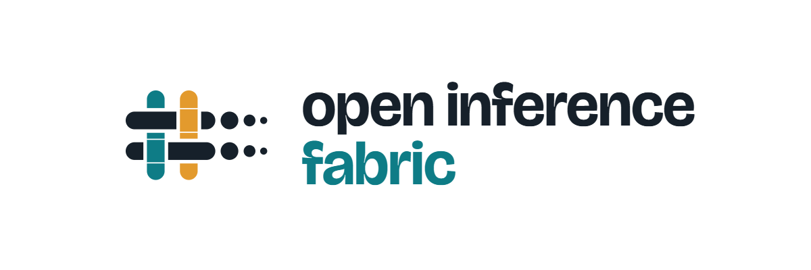

<p align="center">
  <picture>
    <source media="(prefers-color-scheme: dark)" srcset="brand/oif-logo-dark-1200x400.png">
    
  </picture>
</p>

# Open Inference Fabric

[](https://github.com/openinferencefabric/oif/actions/workflows/ci.yml)

**One open-source platform to schedule, serve, benchmark and observe LLMs on NVIDIA and AMD GPUs.**

Open Inference Fabric (OIF) assembles open-source AI infrastructure into a suite you can install on GPU servers with one command:

| Layer | Built on |
| --- | --- |
| Orchestration | NVIDIA Run:ai (open source) with the KAI Scheduler: projects, quotas, node pools |
| Serving | NVIDIA Dynamo with vLLM (SGLang and TensorRT-LLM later), one OpenAI-compatible endpoint; AMD GPUs through a ROCm build |
| Performance | NVIDIA AIPerf benchmark profiles and comparison reports |
| Observability | Prometheus and Grafana with DCGM and AMD device metrics exporters, normalised into one vendor-neutral schema |
| Platform | Upstream Kubernetes (kubeadm), NVIDIA GPU Operator, AMD GPU Operator |

> **Status: v0.1 in development.** Multi-node HA and dual-vendor orchestration are advanced; serving and gateway are next. Start with the [install guides](docs/guides/README.md); progress is in [TASKS.md](TASKS.md).

## Why

Teams with both NVIDIA and AMD GPUs run separate stacks per vendor: different serving endpoints, different dashboards, no shared quotas, and benchmarks that cannot be compared. OIF puts both vendors behind one scheduler, one API, one benchmark tool and one set of dashboards — with a clean, reversible installer.

## Usage

```bash
./oif check                                # read-only host and GPU report
cp .env.example .env && $EDITOR .env      # addresses, tokens
sudo ./oif install                         # questions first, then unattended
sudo ./oif status | plan                   # progress; preview of uninstall
sudo ./oif uninstall                       # back to the OS default
sudo ./oif bench --profile quick          # on a GPU node: Dynamo against its plain engine, AIPerf, HTML report
```

## Documentation

| Document | Purpose |
| --- | --- |
| [Project brief](docs/PROJECT-BRIEF.md) | One page for partners, sponsors and new contributors |
| [PRD](docs/PRD.md) | What we are building and why; goals and success criteria |
| [SDLC](docs/SDLC.md) | How we build, test, document and release (process for humans and agents) |
| [Architecture](docs/ARCHITECTURE.md) | Layers, flows, telemetry schema, repository layout |
| [Benchmark method](docs/BENCHMARK.md) | How `oif bench` measures: hardware configurations, metrics, workloads, quality benchmarks |
| [Design](docs/DESIGN.md) | CLI, dashboard and report conventions |
| [Rules](docs/RULES.md) | How code is written and changed |
| [Tasks](TASKS.md) | What we build next, in order |
| [Decisions](docs/DECISIONS.md) | Architecture Decision Records (ADRs) |
| [Memory](docs/MEMORY.md) | Current project state |
| [Test plan](docs/TEST_PLAN.md) | What "working" means |
| [Install guides](docs/guides/README.md) | Step-by-step install and deployment |
| [Upstream changes](docs/UPSTREAM.md) | Every patch and workaround, prepared for the Run:ai and KAI Scheduler projects |
| [Design sketches](docs/design/) | Vendor-agnostic job model, lab acceptance checks |
| [Presentations](presentations/) | Feature and product decks |
| [Security](docs/SECURITY.md) | Security requirements |
| [Research](docs/RESEARCH.md) | Sources behind the decisions |

## Reference hardware

Developed and tested on one server: AMD EPYC 9684X, 751 GiB RAM, NVIDIA RTX A6000 and AMD Radeon PRO W7900, Ubuntu 26.04. Multi-node work uses the [hybrid-gpu-lab](https://github.com/manmohanbrahma/hybrid-gpu-lab).

## Contributing

Testers with NVIDIA, AMD or mixed GPU servers, reviewers for the upstream Run:ai and KAI work
([docs/UPSTREAM.md](docs/UPSTREAM.md)), and contributors are all welcome: see [CONTRIBUTING.md](CONTRIBUTING.md) and
the [Code of Conduct](CODE_OF_CONDUCT.md). Report security problems privately ([docs/SECURITY.md](docs/SECURITY.md)).

## Licence

Apache-2.0. NVIDIA, Run:ai, Dynamo, AMD, ROCm and Radeon are trademarks of their owners; this project is not affiliated with or endorsed by them.
