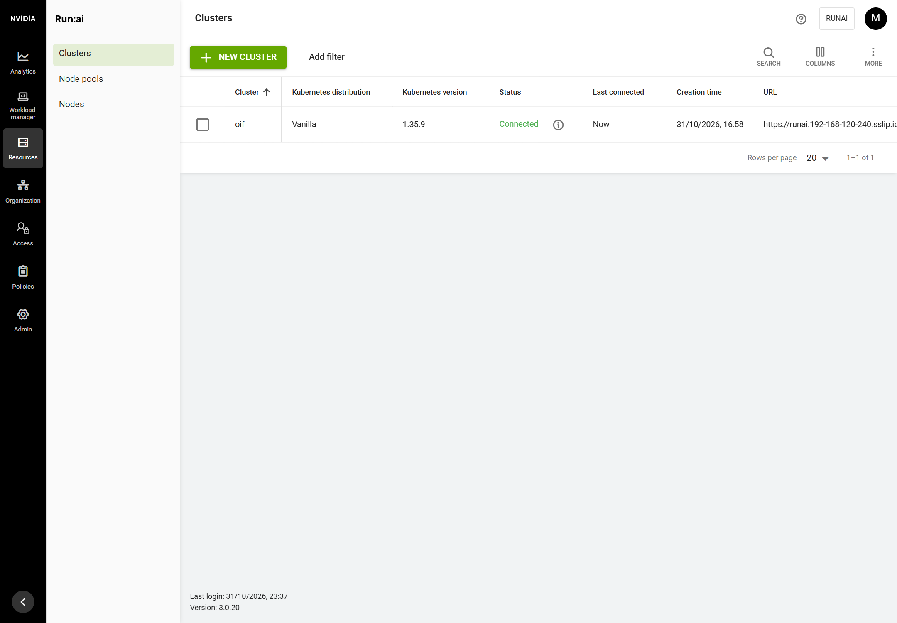
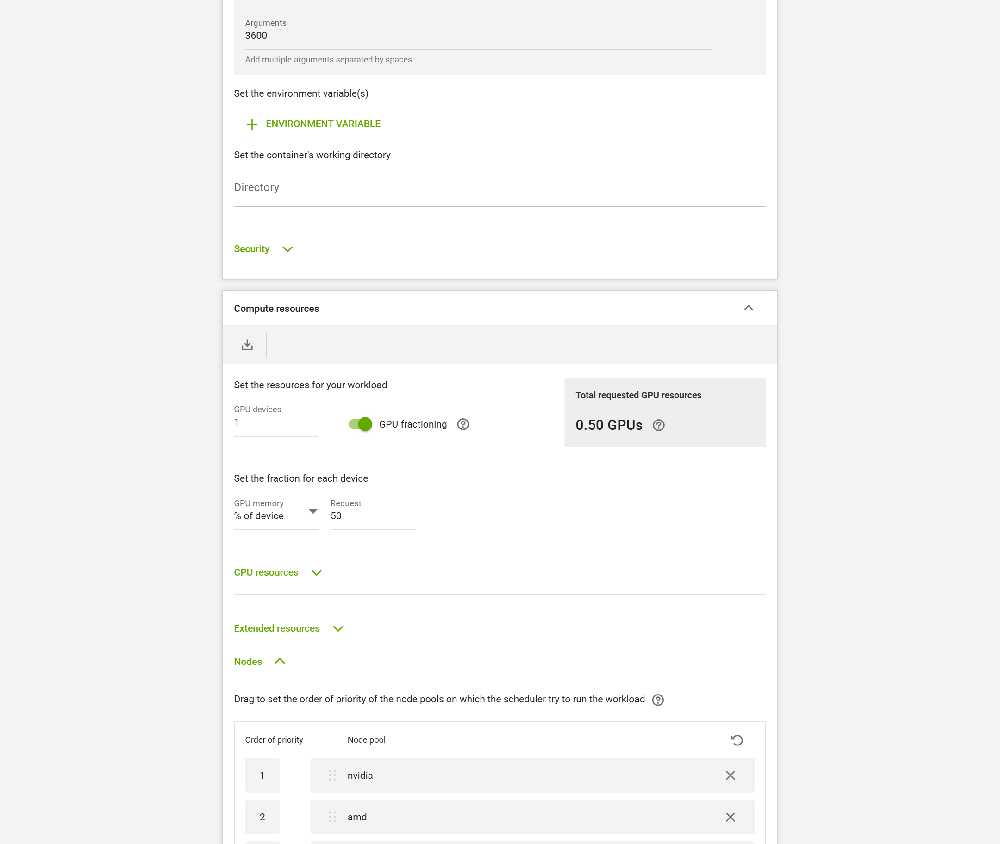
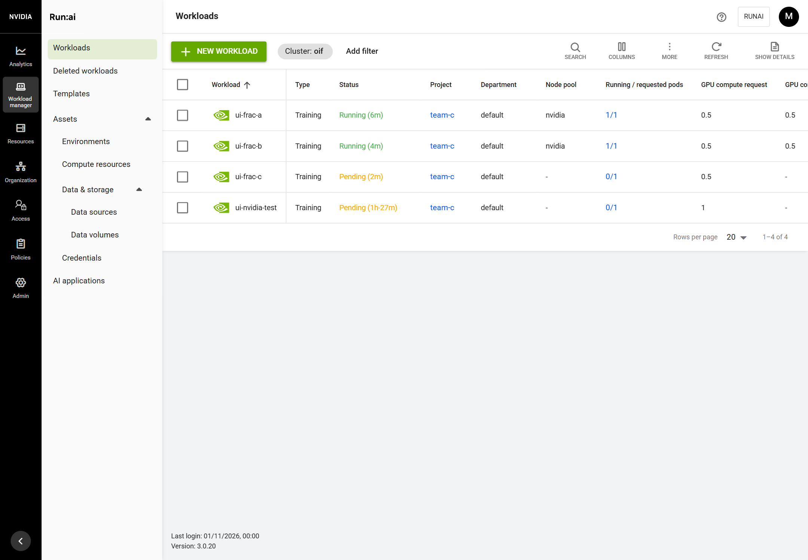
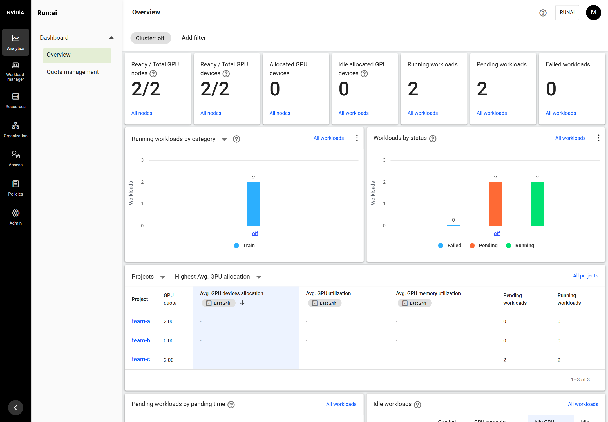

# Guide 11: GPU fractions on NVIDIA GPUs

Step T-108 (ADR-032). Tested on the lab cluster (guide 10) on 2026-11-01.

## What you get

- The NVIDIA driver on every NVIDIA node is the **615** branch (`615-server`, open kernel modules, from the Ubuntu archive), the first branch Run:ai 3.0's GPU fractions support. An installed node on an older branch is upgraded in place with one reboot.
- Run:ai's GPU-fractioning daemons (`fractiond`, an NRI plugin that injects each container's GPU memory limit, and `mpsd`) run on those nodes, and the cluster is no longer **Missing prerequisites**.
- A workload can ask for part of a GPU in the Run:ai UI (**GPU fractioning**, % of the device) or with the `gpu-fraction` / `gpu-memory` annotations. Two half-GPU workloads share one RTX A6000; each container sees and can allocate only its half (24,570 MiB of 49,140 MiB), enforced by the driver.
- Quotas count fractions: with 1 NVIDIA GPU of quota, two 0.5 workloads run and a third waits.

AMD GPUs are not shared yet: upstream has no fractions for the Radeon PRO W7900. Spike S-7 decides whether oif adds them (ADR-032).

## Before you start

- A cluster installed with oif (guides 1 to 10), with the NVIDIA GPU Operator 26.7.1 (toolkit v1.20.1 and device plugin v0.20.1, both already in that release) and containerd 2.x with NRI on (the default).
- An NVIDIA GPU of the Turing generation or newer: from 615 NVIDIA ships only the open kernel modules.

## Steps

1. Get the oif version with T-108 (driver branch `615-server` in `versions.env`) and run the install again on the first node:

   ```bash
   cd ~/open-inference-fabric && git pull
   sudo ./oif install
   ```

   On a new cluster this is part of the normal install. On an installed one, oif re-runs only the node stages and `runai-fractions`; the NVIDIA node upgrades and reboots once:

   ```text
   == stage: nodes (32ab32db7c74 -> fa4f55adbbfc)
     [192.168.120.22] == stage: nvidia-driver
     [192.168.120.22] == upgrading the NVIDIA driver 595.91.07 to the 615-server branch (one reboot)
     [192.168.120.22]   [ok] older NVIDIA driver branch removed
     [192.168.120.22]   [ok] NVIDIA 615-server driver installed; it loads after the reboot
     [192.168.120.22]   [!] a reboot is needed to load the NVIDIA 615-server driver instead of 595.91.07
   == 192.168.120.22: rebooting it for its GPU driver
     [ok] 192.168.120.22 back after the reboot
     [192.168.120.22]   [ok] NVIDIA driver 615.71.09: NVIDIA RTX A6000
   == stage: runai-fractions (3.0.20 -> 3.0.20 615-server)
     [ok] GPU fractions available (driver 615.71.09)
   == install finished
   ```

   GPU workloads on that node stop during the reboot (about 2 minutes on the lab).

2. In the Run:ai UI, **Resources > Clusters**: the cluster is **Connected**, no longer Missing prerequisites.

   

3. Submit a half-GPU workload: **Workload manager > Workloads > New workload > Training**, a project, **Start from scratch**, a name, then:
   - **Environment**: the image, for example `nvcr.io/nvidia/k8s/cuda-sample:vectoradd-cuda12.5.0`; under Runtime settings a command (`sleep`, arguments `3600`) to keep it running for the test;
   - **Compute resources**: GPU devices `1`, switch on **GPU fractioning**, GPU memory **% of device** `50`. The total reads **0.50 GPUs**;
   - **Nodes**: the node pools in order, `nvidia` first.

   

   The pools listed are the project's default order: on a multi-node cluster oif sets `nvidia`, `amd`, `default` for every department and projects inherit it (T-125, [guide 12](12-one-job-one-vendor.md)).

4. Submit a second one the same way, and a third.

## Check it worked

The UI: two workloads running at 0.5 GPU each in pool `nvidia`, the third pending.





On the first node:

```bash
kubectl get gpufractioningconfig default -o jsonpath='{range .status.conditions[*]}{.type}={.status} {.message}{"\n"}{end}'
kubectl -n runai get pods -o wide | grep fractioning
kubectl -n runai-team-c get pods -o wide
kubectl -n runai-team-c exec <pod> -- nvidia-smi --query-gpu=name,memory.total --format=csv
```

```text
FractiondReady=True 1 of 1 pods ready
MpsdReady=True 1 of 1 pods ready
Ready=True all components are healthy
gpu-fractioning-fractiond-w5zxl   2/2   Running   gpu-nvidia
gpu-fractioning-mpsd-29drn        1/1   Running   gpu-nvidia
ui-frac-a-g6zjd   1/1   Running   gpu-nvidia
ui-frac-b-xqs69   1/1   Running   gpu-nvidia
ui-frac-c-z6wt4   0/1   Pending   <none>
name, memory.total [MiB]
NVIDIA RTX A6000, 24570 MiB
```

Both running pods are bound to the same GPU (the same UUID in `NVIDIA_VISIBLE_DEVICES`) and carry `NVIDIA_GPU_MEMORY_LIMIT=24570`. The third waits with `Node-Pool 'nvidia': no nodes with enough resources were found: ... GPUs`. Full output: `docs/evidence/T-108/`.

## What changed on the host

| Change | Reversed by uninstall |
| --- | --- |
| NVIDIA packages of the `615-server` branch installed (recorded); the older branch's packages removed by the upgrade | the recorded 615 packages are purged; the older branch is not put back (uninstall returns to the OS default, which has no NVIDIA driver) |
| `/etc/modprobe.d/90-oif-nouveau.conf` (unchanged by an upgrade) and the initramfs | removed, initramfs rebuilt |
| Run:ai's `GpuFractioningConfig default` without oif's blocking node selector | goes with Run:ai |

## Troubleshooting

| Symptom | Cause and fix |
| --- | --- |
| A fractional workload stays pending with `No node in the default node-pool has GPU resources` | The project's default node pools are `default` only: put `nvidia` (and `amd`) first in the form's Nodes section, or see [guide 12](12-one-job-one-vendor.md) (T-125). |
| `gpu-fractioning` pods not on an NVIDIA node, cluster still Missing prerequisites | The node runs a driver older than 615: `nvidia-smi` on it; run `sudo ./oif install` again. The `GpuFractioningConfig` condition names the reason (`GPUDriverVersionUnsupported`). |
| `node is not ready for fractional GPU scheduling` in the events, for pool `amd` | Expected: AMD GPUs have no fractions (S-7). |
| The Overview shows Allocated GPU devices 0 while fractional workloads run | Seen on the lab with whole-GPU workloads too; the Workloads and Projects pages show the allocations (team-c: 1.00). |
