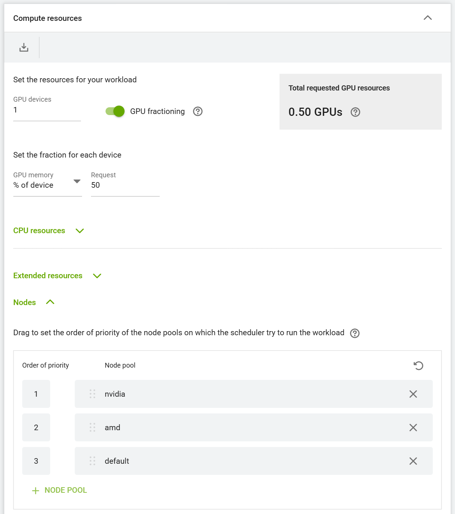
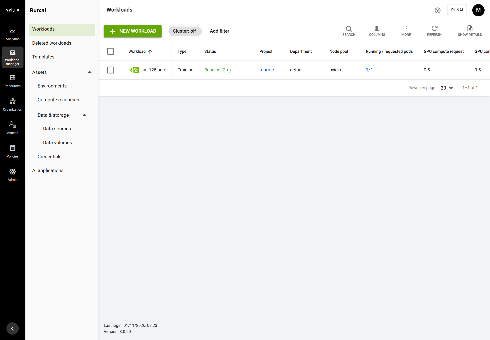

# Guide 12: One job, one vendor

Steps T-125, T-129 and T-140 (ADR-032). T-125 tested on the lab cluster (guide 10) on 2026-11-01; T-129 on 2026-11-03 with
`tests/lab/t129-vendor-pool.sh` (10/10, docs/evidence/T-129/); T-140 on 2026-11-04 with `tests/lab/t140-vendor-size.sh` (13/13) and the form in a browser (docs/evidence/T-140/).

## What you get

On a cluster whose GPU servers each have one vendor (guide 10: pools `nvidia` and `amd`):

- A workload submitted **without choosing a node pool** lands where a GPU exists. oif sets every Run:ai department's default node pools to the GPU pools first, then `default` (`nvidia, amd, default` on the lab); projects without their own order inherit it. Before, they inherited `default` only, which has no GPU, and a UI workload waited there forever.
- A **multi-pod workload runs in one pool**: KAI schedules all pods of a workload as one PodGroup, bound to one node pool, so a job never spreads over the NVIDIA and the AMD node.
- A **pod asking for NVIDIA and AMD GPUs at once is refused** when it is created (a Kubernetes ValidatingAdmissionPolicy, `oif-one-gpu-vendor`), instead of waiting for a node that cannot exist.
- A **pod asking for one vendor's GPU stays with that vendor** (T-129). KAI counts every GPU alike, so a pod asking for `nvidia.com/gpu` (the Run:ai form's "GPU devices 1") whose NVIDIA quota was full could be placed on the AMD GPU in pool `amd`, where it cannot start (UI test UI-10b). oif's webhook `oif-vendor-pool` pins such a pod to its vendor's pool (label `runai/node-pool`, node selector `oif.ai/gpu-vendor`): it waits on its own quota instead.
- A **pod without a GPU follows its workload** (T-129). A pod with no pool of its own takes the pool of the workload that owns it, for example a Dynamo frontend next to its worker (S-4: the frontend landed in pool `amd` while the worker ran in `nvidia`). Name the pool on the workload object (`runai/node-pool: nvidia` on the Job, Deployment or DynamoGraphDeployment); its pods get it.
- A **GPU fraction that names no vendor must choose** (T-129). A fraction is asked for by annotation (`gpu-fraction`, `gpu-memory`), not by a vendor's resource; if its pools allow both vendors it is refused (ValidatingAdmissionPolicy `oif-vendor-agnostic-gpu`) with the message to keep one pool. The oif templates already choose one.

- **The vendor and the size are one choice in the form** (T-140). Run:ai's **Compute resources** section gets a **GPU vendor** choice (NVIDIA / AMD / No GPU, from oif's patch 0005; see the next section). A pod that asks for one vendor's GPU while all its node pools are the other vendor's is **refused** with a message to choose the vendor, instead of being moved: before, the form's "GPU devices 1" with pool `amd` ran on the NVIDIA GPU.

On a single node with both vendors (guides 1 to 9) the stages change nothing: there is no per-vendor pool. With one GPU vendor there is nothing to choose, and the webhook and the second policy are not installed.

## Choosing the GPU vendor and size (T-140)

In **Workload manager > Workloads > New workload** (training, workspace, inference, and their templates), the **Compute resources** section starts with **GPU vendor**, when the project has the per-vendor pools:

| Choice | Node pools | Whole GPUs | Fractions and GPU memory |
| --- | --- | --- | --- |
| NVIDIA | `nvidia` only | **GPU devices** (`nvidia.com/gpu`) | the form's fields, enforced by NVIDIA's fractioning (guide 11) |
| AMD | `amd` only | **GPU devices** in the form, sent as `amd.com/gpu` | the form's fields, on oif's AMD fractions (guide 13), hard-capped where the kernel supports it |
| No GPU | `default` only | none | none |

Switching the vendor sets the pools and converts a whole-GPU count between `nvidia.com/gpu` and `amd.com/gpu`. Loading a compute resource or template shows the vendor it implies. Fractions by GPU memory (for example 12 GB) work on both vendors: on AMD nodes oif's KAI reads AMD's own VRAM label (guide 13).

**Compute presets.** oif also creates one compute resource per vendor and size, as quick picks under **Load** (and for the API and CLI): `nvidia-1-gpu`, `nvidia-half-gpu`, `nvidia-quarter-gpu`, `nvidia-12gb`, `amd-1-gpu` (as `amd.com/gpu`), `amd-half-gpu`, `amd-quarter-gpu`, `amd-12gb`. Only the vendors the cluster has are created; the AMD fractions only when AMD fractions are on. They come from [platform/runai/compute-presets.json](../../platform/runai/compute-presets.json); stage `runai-presets` keeps them in step and removes oif's own presets of a vendor that is gone (their description starts with `oif:`), never anyone else's.

**Through the API or YAML** there is no form: name one pool (`nodePools: ["amd"]`, or the label `runai/node-pool`) and ask for that vendor's GPU (`amd.com/gpu` as an extended resource for whole AMD GPUs). A pod asking for `nvidia.com/gpu` in pool `amd` (or `amd.com/gpu` in pool `nvidia`) is refused:

```text
admission webhook "vendor-pool.oif.ai" denied the request: oif-vendor-pool: this workload runs in the AMD GPU pool
but asks for nvidia.com/gpu (Run:ai's "GPU devices"): for whole AMD GPUs choose AMD as the GPU vendor, or ask for amd.com/gpu
```

Check it on the lab:

```bash
sudo tests/lab/t140-vendor-size.sh            # presets, the AMD memory label, one workload per vendor and size, the refusal, the patched UI
sudo tests/lab/t140-vendor-size.sh --dynamo   # also the half-GPU Dynamo sample (guide 16)
```

## Before you start

- A multi-node cluster installed with oif (guide 10), with the Run:ai node pools per vendor (T-123).
- Kubernetes 1.30 or later (ValidatingAdmissionPolicy is GA; the lab runs 1.35).

## Steps

1. Get the oif version with T-125 and run the install again on the first node:

   ```bash
   cd ~/open-inference-fabric && git pull
   sudo ./oif install
   ```

   On a new cluster this is part of the normal install. On an installed one only the new stage runs:

   ```text
   == stage: one-vendor
       department default default node pools nvidia,amd,default
     [ok] workloads without node pools try: nvidia, amd, default
   validatingadmissionpolicy.admissionregistration.k8s.io/oif-one-gpu-vendor created
   validatingadmissionpolicybinding.admissionregistration.k8s.io/oif-one-gpu-vendor created
     [ok] a pod asking for NVIDIA and AMD GPUs at once is refused (ValidatingAdmissionPolicy oif-one-gpu-vendor)
   == install finished
   ```

   The order lists only the vendors the cluster has: a cluster with NVIDIA nodes only gets `nvidia, default`.

   With both vendors, T-129's stage follows (it builds the webhook once, a few minutes):

   ```text
   == stage: vendor-pool
       == oif-vendor-pool
       == image oif.local/oif/oif-vendor-pool:... from gcr.io/distroless/static-debian12:nonroot@...
     [ok] certificate for oif-vendor-pool.oif-vendor-pool.svc from oif's CA
     [ok] a pod asking for one vendor's GPU, or whose workload is in a vendor's pool, runs in that pool (webhook oif-vendor-pool)
     [ok] a GPU fraction that names no vendor must choose pool nvidia or amd (ValidatingAdmissionPolicy oif-vendor-agnostic-gpu)
   ```

2. In the Run:ai UI, submit a workload: **Workload manager > Workloads > New workload > Training**, a project, **Start from scratch**, an image and, for example, GPU devices `1` with **GPU fractioning** at 50 % (guide 11). Open **Nodes**: the order is already `nvidia`, `amd`, `default`. A fraction names no vendor: keep only the pool of the GPU you want (the **X** on the other rows), or the workload is refused (T-129). Whole GPUs (fractioning off) ask for `nvidia.com/gpu` and stay on NVIDIA by themselves.

   

## Check it worked

The workload runs in pool `nvidia`:



On the first node, the lab test runs a 2-pod half-GPU Job without a node pool, then tries a pod with both vendors:

```bash
sudo tests/lab/t123-runai.sh
```

```text
T-125 one job, one vendor
        default nvidia,amd,default
  PASS  every department's default node pools are nvidia,amd,default
        job pods running on: gpu-nvidia gpu-nvidia
  PASS  a 2-pod Job without a node pool runs both pods on the NVIDIA node (gpu-nvidia)
  PASS  the Job is one PodGroup in pool nvidia
        both vendors: Error from server (Forbidden): ... ValidatingAdmissionPolicy 'oif-one-gpu-vendor' ...
  PASS  a pod asking for NVIDIA and AMD GPUs is refused

T-123: PASS (31 checks)
```

By hand:

```bash
kubectl get validatingadmissionpolicy oif-one-gpu-vendor
kubectl -n runai-<project> get podgroups -L runai/node-pool
```

Full output: `docs/evidence/T-125/`. Since T-129 the lab test's Job names pool `nvidia` on the Job only; the webhook gives it to both pods.

T-129's own test fills team-c's NVIDIA quota and checks that a second NVIDIA pod waits instead of moving to the AMD GPU, that a fraction without a vendor is refused, and that a GPU-less pod takes its Deployment's pool:

```bash
sudo tests/lab/t129-vendor-pool.sh
kubectl -n oif-vendor-pool logs deploy/oif-vendor-pool     # one line per pod it pinned, and why
```

## What changed on the host

Nothing on the hosts but one image; cluster changes:

| Change | Reversed by uninstall |
| --- | --- |
| Run:ai departments' default node pools (`nvidia, amd, default`) | goes with Run:ai |
| ValidatingAdmissionPolicy and binding `oif-one-gpu-vendor` | goes with the cluster (`kubeadm reset`) |
| T-129, with both vendors: namespace `oif-vendor-pool` (webhook Deployment, Service, TLS secret), MutatingWebhookConfiguration `oif-vendor-pool`, ClusterRole and binding `oif-vendor-pool`, ValidatingAdmissionPolicy and binding `oif-vendor-agnostic-gpu` | go with the cluster; removed by the install when the cluster has one GPU vendor |
| T-129: image `oif.local/oif/oif-vendor-pool` in containerd on every node; certificate `vendor-pool.crt` and key in oif's PKI folder | go with containerd's data and oif's state folder |

## Troubleshooting

| Symptom | Cause and fix |
| --- | --- |
| A workload without a pool still waits in `default` (`No node in the default node-pool has GPU resources`) | Its project has its own order, which wins over the department's: set the GPU pools first on the project (`PUT /api/v1/org-unit/projects/<id>` with `"defaultNodePools": ["nvidia", "amd", "default"]` and the project's `resources`, no `name`), or pick the pool in the form's **Nodes** section. A workload submitted before T-125 keeps the order it was created with: submit it again. |
| `pods "..." is forbidden: ValidatingAdmissionPolicy 'oif-one-gpu-vendor'` | Expected: one pod asked for `nvidia.com/gpu` and `amd.com/gpu`. Split it into one workload per vendor. |
| `ValidatingAdmissionPolicy 'oif-vendor-agnostic-gpu' ... choose one GPU vendor` | Expected: a GPU fraction whose pools allow NVIDIA and AMD. Keep one pool in the form's **Nodes**, label the pod or its workload `runai/node-pool: nvidia` (or `amd`), or use an oif template. |
| An NVIDIA workload waits on quota while the AMD GPU is free | Expected since T-129: it no longer moves to the other vendor's GPU, where it could not start. Free NVIDIA quota or give the project more. |
| A Dynamo frontend (no GPU) runs in another pool than its worker | Its workload object has no `runai/node-pool` label: add it to the DynamoGraphDeployment (or to each component's pod template). Check the webhook's log for the pod. |
| A workload has no pod; its events say `oif-vendor-pool: this workload runs in the AMD GPU pool but asks for nvidia.com/gpu` | Expected (T-140): it asked for NVIDIA's GPU in pool `amd`. Choose **AMD** as the GPU vendor in the form, or ask for `amd.com/gpu` (extended resource) through the API. The reverse message means `amd.com/gpu` in pool `nvidia`. |
| No **GPU vendor** choice in the form | The project has no `nvidia` or `amd` pool (one vendor, or a single node), or the Run:ai UI is not the patched one: `sudo ./oif install` (stage runai-patches), guide 8. |
| Pods are no longer pinned to a vendor's pool | The webhook is down and fails open (pods are created as they are): `kubectl -n oif-vendor-pool get pods`, `logs deploy/oif-vendor-pool`. |
| A distributed (PyTorch, MPI) workload: `distributed framework PyTorch is not available` | Run:ai's distributed workloads need the Kubeflow training operator, which oif does not install. A multi-pod Kubernetes Job with `schedulerName: runai-scheduler` works and stays in one pool. |
