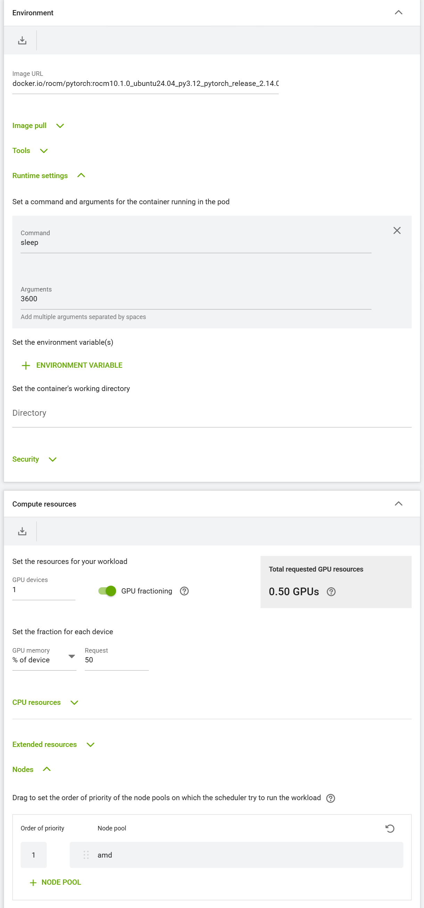
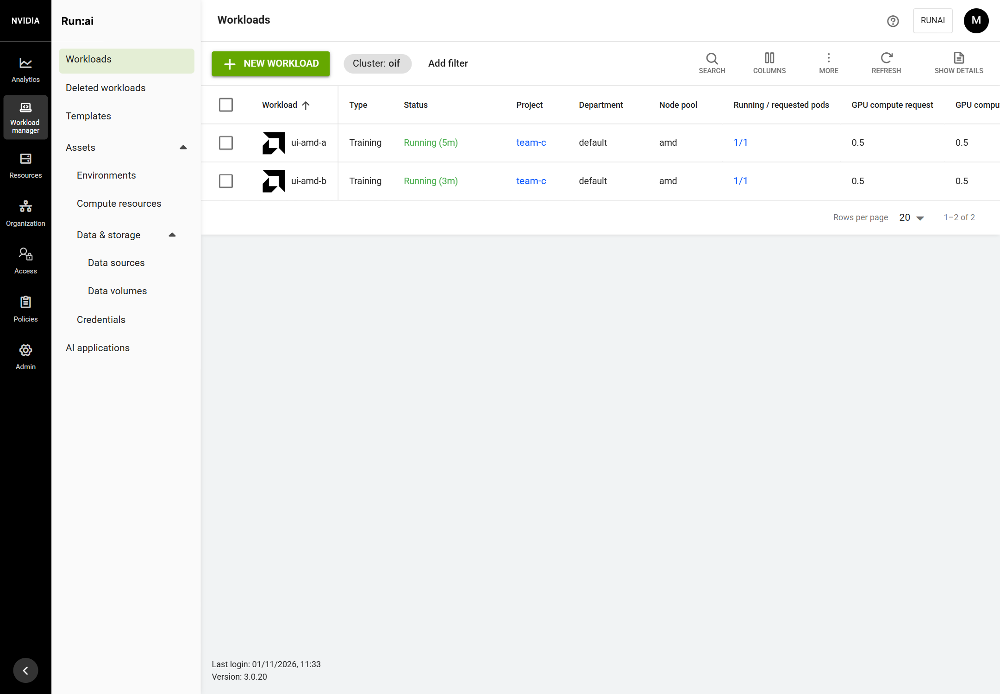
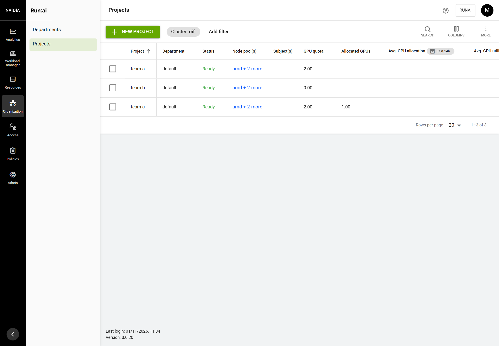

# Guide 13: GPU fractions on AMD GPUs

Step T-126 (ADR-032, spike S-7), with the hard VRAM cap of T-139 (spike S-8). Tested on the lab cluster (guide 10) on
2026-11-01; the VRAM cap on 2026-11-03 (quick test and vLLM benchmark), the installed cap on 2026-11-03 with `tests/lab/t139-vram-cap.sh` (10/10, docs/evidence/T-139/).

## What you get

- A workload asks for part of an AMD GPU exactly as for an NVIDIA one: in the Run:ai UI **GPU fractioning**, % of the device, or the `gpu-fraction` annotation. Two half-GPU workloads share one Radeon PRO W7900, each sees the GPU (45 GiB) and gets half of its compute (24.2 TFLOPS each, fp16).
- Run:ai counts the fractions: the Workloads page shows 0.5 GPU and 22.5 GB each in pool `amd`; with 1 AMD GPU of quota, two halves run and a third waits (`team-c-amd quota is 1 GPUs, while 1 GPUs are already allocated`).
- NVIDIA fractions (guide 11) and whole GPUs of both vendors work as before.

**Memory isolation is hard where the kernel supports it (T-139).** KAI's gpu-fractioning `fractiond`, with oif's AMD backend, caps each fraction pod's GPU memory with the Linux dmem cgroup: `dmem.max` on the pod's cgroup is its share of the VRAM, and the kernel refuses allocations past it. This needs Linux 6.14 or newer with `amdgpu` (the lab's Ubuntu 26.04 runs 7.0). Measured on the W7900:

- a 0.25 pod asking for 30 GiB was stopped at 11,264 MiB by its 11,516 MiB cap, while a 0.5 pod on the same GPU allocated 20 GiB;
- a 0.5 pod whose vLLM asked for 0.9 of the GPU was refused with `HIP out of memory` at its 22.5 GiB cap;
- a capped half-GPU vLLM pod served within about 1% of the whole GPU (time per token, latency, throughput), the same as NVIDIA's fractions on an A6000 ([report](https://manmohanbrahma.github.io/gpu-benchmark/amd-fraction-dmem-cap/)).

What the pod sees is still the whole GPU: `amd-smi` shows 46,064 MB and `torch.cuda.mem_get_info()` 45 GiB (ROCm does not read the cap yet, ROCm/rocm-systems#14860), where `nvidia-smi` in an NVIDIA half shows 24,570 MiB. So the workload still has to be told its share (T-127):

- **PyTorch is sized automatically.** The plugin sets PyTorch's allocator to the pod's share (`PYTORCH_ALLOC_CONF=per_process_memory_fraction:0.5`, also the HIP and CUDA names, added to the image's own allocator settings). vLLM's default `--gpu-memory-utilization 0.9` would try to take 0.9 of the whole GPU and fail at the cap: set it to the share or just below (for example `0.45`).
- **Everything else gets the share** in `OIF_GPU_MEMORY_FRACTION` (for example `0.5`) to size itself. A process that ignores it is stopped at its share by the kernel; it no longer takes its neighbour's memory.

On a node whose kernel cannot cap VRAM, or with `AMD_VRAM_CAP=none`, the share is soft as before T-139: a pod that lifts PyTorch's cap (T-128: `torch.cuda.set_per_process_memory_fraction(1.0)`) takes more than its share, limited only by the free memory. The install says which nodes are which. Compute is time-sliced on both: AMD has no counterpart to NVIDIA's MPS compute sharing.

How it works:

| Piece | What it does |
| --- | --- |
| KAI Scheduler v0.18.3, rebuilt with oif's patches (`patches/kai/`), on every cluster with an AMD GPU (T-141; KAI's stock images without AMD GPUs or with `AMD_FRACTIONS=none`) | the scheduler skips NVIDIA's readiness check on AMD GPU nodes; the binder reserves the GPU with a reservation pod that holds an `amd.com/gpu`, and writes the GPU's PCI address into the pod (`oif.ai/amd-gpu`); the scheduler reads an AMD node's GPU memory from AMD's label `beta.amd.com/gpu.vram.<size>`, so fractions by GPU memory (12 GB) schedule there (0005, T-140); on a node with GPUs of both vendors, a pod's whole GPUs of one vendor must fit that vendor's free GPUs (0006, T-116); a required topology level is honoured in a pool whose nodes share one domain, such as a one-node pool (0007, T-132) |
| oif-amd-share, an NRI plugin (`images/oif-amd-share/`), on every AMD GPU node | when containerd creates the pod's container, gives it `/dev/kfd` and that GPU's `/dev/dri` nodes, and sets `OIF_GPU_MEMORY_FRACTION` |
| fractiond from KAI's gpu-fractioning with oif's AMD backend (`--gpu-vendor=amd`, built from `GPU_FRACTIONING_REF` in `versions.env`), DaemonSet `oif-fractiond` on AMD nodes labelled `oif.ai/amd-vram-cap=dmem` | when containerd creates a fraction pod's container, writes `dmem.max` = share × VRAM on the pod's cgroup (T-139); refuses the container if it cannot |
| ValidatingAdmissionPolicy `oif-amd-share-annotations` | only KAI's binder may set the `oif.ai/amd-gpu` annotations, so no one gets a GPU outside Run:ai's quotas |
| containerd on AMD-only GPU nodes | runtime class `nvidia` runs `runc` there: KAI's admission gives every fraction pod that class before a node is chosen |

## Before you start

- A multi-node cluster installed with oif (guide 10): AMD GPUs on nodes of their own, Run:ai node pool `amd` (T-123). On a single node with both vendors, AMD GPUs stay whole: the install
  still runs the patched KAI there (no sharing plugin), so a pod's whole GPUs of one vendor are placed only where that
  vendor's GPUs are free (patch 0006, T-116, T-141).
- GPU fractions on NVIDIA working or not needed (guide 11).
- Internet access for the build: the KAI source (pinned checksum), Go modules and the base images.

## Steps

1. Get the oif version with T-126 and run the install again on the first node:

   ```bash
   cd ~/open-inference-fabric && git pull
   sudo ./oif install
   ```

   On an installed cluster, the node stage `amd-runtime` changes the AMD node only, then stage `amd-fractions` builds and switches on the patched KAI (10 to 30 minutes for the build):

   ```text
   [192.168.120.21]   [ok] runtime class nvidia runs runc on this AMD GPU node (GPU fractions)
   == stage: amd-fractions
       == patch 0001-common-amd-gpu-node.patch ... 0006-scheduler-one-vendor-gpus-on-mixed-nodes.patch
       ok  .../pkg/binder/plugins/nvfractions   ok  .../pkg/scheduler/plugins/gpusharingnodevalidation   ...
       == image oif.local/kai-scheduler/scheduler:v0.18.3-oif-216ce155df72 from ghcr.io/kai-scheduler/kai-scheduler/scheduler:v0.18.3
     [ok] patched image oif.local/kai-scheduler/binder:v0.18.3-oif-216ce155df72 on every node (4 loaded now)
     [ok] KAI scheduler and binder patched for AMD GPU fractions (v0.18.3-oif-216ce155df72)
     [ok] hard VRAM cap (dmem) for AMD fractions on gpu-amd
     [ok] AMD GPUs on gpu-amd can be shared: Run:ai GPU fractions in pool amd; memory isolation is hard on gpu-amd
   == install finished
   ```

   A node whose kernel cannot cap VRAM gets a warning instead, and its fractions keep a soft share:

   ```text
     [!] gpu-amd (kernel 6.8.0-49-generic): no amdgpu VRAM region in /sys/fs/cgroup/dmem.capacity (needs Linux 6.14+): its AMD fractions keep a soft memory share
   ```

   To keep the soft share everywhere, set `AMD_VRAM_CAP=none` in `.env` and run `sudo ./oif install --reconfigure`.

2. In the Run:ai UI the quickest way is a template (T-127): **Workload manager > Workloads > New workload > Training**, a project with AMD quota, template **pytorch-rocm-half-gpu**, a name, **Create training**. It has the ROCm image, half a GPU and pool `amd` already set, and its log shows the GPU, its share and five minutes of compute. For Jupyter: **New workload > Workspace**, template **jupyter-lab-rocm-half-gpu**.

   Or from scratch: **Start from scratch**, a name, then:
   - **Environment**: a ROCm image, for example `docker.io/rocm/pytorch:rocm10.1.0_ubuntu24.04_py3.12_pytorch_release_2.14.0`, and its command;
   - **Compute resources**: GPU devices `1`, **GPU fractioning** on, GPU memory **% of device** `50`;
   - **Nodes**: keep only `amd` (the **X** on the `nvidia` and `default` rows). The form starts with the project's order (`nvidia`, `amd`, `default`, guide 12), and a fraction placed first on `nvidia` runs on the NVIDIA GPU.

   

3. Submit a second one the same way.

## Check it worked





On the first node:

```bash
kubectl -n oif-system get pods -o wide                      # oif-amd-share on every AMD GPU node
kubectl -n runai-reservation get pods -o wide               # one reservation pod per shared GPU (amd.com/gpu: 1)
kubectl -n runai-<project> get pods -o wide
kubectl -n runai-<project> exec <pod> -- python3 -c "import os,torch; print(os.environ['OIF_GPU_MEMORY_FRACTION'], torch.cuda.get_device_name(0))"
```

```text
oif-amd-share-7qk5w   1/1   Running   gpu-amd
gpu-reservation-3117eb96bc13da22   1/1   Running   gpu-amd
ui-amd-a-f9s86   1/1   Running   gpu-amd
ui-amd-b-55jwg   1/1   Running   gpu-amd
0.5 AMD Radeon Pro W7900
```

### Inside a workload (a notebook from **jupyter-lab-rocm-half-gpu**)

Run:ai's allocation record stays on the pod object; inside the container the share shows as oif's variables and the
PyTorch cap:

```python
import os, torch
for k in ("RUNAI_PROJECT", "RUNAI_JOB_NAME", "OIF_GPU_PCI", "OIF_GPU_MEMORY_FRACTION", "PYTORCH_ALLOC_CONF"):
    print(f"{k:25} {os.environ.get(k)}")
free, total = torch.cuda.mem_get_info()
share = float(os.environ["OIF_GPU_MEMORY_FRACTION"])
print(f"GPU memory {total/2**30:.1f} GiB, this pod's share {share} = {share*total/2**30:.1f} GiB")
for gib in (20, 25):
    try:
        x = torch.empty(int(gib * 2**30) // 2, dtype=torch.float16, device="cuda"); print(f"{gib} GiB: allocated"); del x
    except torch.OutOfMemoryError:
        print(f"{gib} GiB: refused (over the share)")
```

```text
RUNAI_PROJECT             team-c
RUNAI_JOB_NAME            test
OIF_GPU_PCI               0000:03:00.0
OIF_GPU_MEMORY_FRACTION   0.5
PYTORCH_ALLOC_CONF        per_process_memory_fraction:0.5
GPU memory 45.0 GiB, this pod's share 0.5 = 22.5 GiB
20 GiB: allocated
25 GiB: refused (over the share)
```

`amd-smi` in the pod shows the whole card (46,064 MB, 96 compute units; PyTorch counts 48, the work-group processors of two CUs each): there is no partition. Compute is time-sliced: a half alone on the GPU runs at full speed (49.8 TFLOPS fp16), two busy halves get about 24 each. Run:ai's record, from the first node:

```bash
kubectl -n runai-<project> get pod -l workloadName=<name> -o jsonpath='{.items[0].metadata.annotations}' | tr ',' '
' | grep -E 'runai-allocated|gpu-fraction|oif.ai'
```

```text
"gpu-fraction":"0.5"
"oif.ai/amd-gpu":"0000:03:00.0"
"runai-allocated-gpu-memory":"22500"
"runai-allocated-gpus":"0.5"
```

The lab test `tests/lab/t126-amd-fractions.yaml` runs two halves and a third on pool `amd` and two halves on `nvidia` without the UI. Full output: `docs/evidence/T-126/`.

### The VRAM cap

```bash
kubectl -n oif-system get pods -l app=oif-fractiond -o wide          # fractiond on every capped AMD node
kubectl -n oif-system logs ds/oif-fractiond | grep 'capped AMD GPU memory'
# on the AMD node: the pod's cgroup, by the pod's UID with - written as _
uid=$(kubectl -n runai-<project> get pod <pod> -o jsonpath='{.metadata.uid}' | tr - _)
cat /sys/fs/cgroup/kubepods.slice/*/*pod${uid}.slice/dmem.max
```

```text
oif-fractiond-x2k8w   1/1   Running   gpu-amd
... "msg":"capped AMD GPU memory","pod":"ui-amd-a","gpu":"0000:03:00.0","fraction":0.5,"limitMiB":23032 ...
drm/0000:03:00.0/vram 24150802432
```

`sudo tests/lab/t139-vram-cap.sh` (T-139) checks the cap end to end: the node label, fractiond on the AMD backend, `dmem.max` at half the VRAM on each half-GPU pod, a pod that lifts PyTorch's cap stopped at its share while its neighbour still allocates; `--expect-off` after `AMD_VRAM_CAP=none`.

`sudo tests/lab/t128-hardening.sh` (T-128) checks the rest: the plugin names its GPUs at start, only the binder may set the `oif.ai/amd-gpu*` annotations, a whole AMD GPU and a half never run on the one GPU together (the second waits on quota), the memory limit above (hard with the cap, soft without); options for a replaced image on a node, `AMD_FRACTIONS=none` and a `cluster-redis` restart with a workspace open (it stays logged in). Output: `docs/evidence/T-128/`. The plugin's log on each AMD GPU node starts with:

```text
oif-amd-share: AMD GPUs on this node: 0000:03:00.0
```

## What changed on the host

| Change | Reversed by uninstall |
| --- | --- |
| On AMD-only GPU nodes: `/etc/containerd/conf.d/90-oif-amd-fractions.toml` (runtime `nvidia` = runc), containerd restarted once | the file (and the folder, if oif created it) is removed |
| Five images in containerd on every node: `oif.local/kai-scheduler/{scheduler,binder,resourcereservation}`, `oif.local/oif/oif-amd-share`, `oif.local/oif/oif-fractiond` | go with containerd's data |
| On capped AMD nodes: `dmem.max` on each fraction pod's cgroup; `dmem` turned on in `cgroup.subtree_control` above the pods where the kubelet had not already (kernel 7.0's kubelet has) | the pod's cap goes with the pod; the controller setting goes with the next reboot |
| Cluster: node label `oif.ai/amd-vram-cap=dmem` and DaemonSet `oif-fractiond` (T-139) | `AMD_VRAM_CAP=none` (`sudo ./oif install --reconfigure`) removes both; running pods keep their cap until they end |
| Cluster: RunaiConfig points KAI at the patched images; namespace `oif-system` (plugin DaemonSet); policy `oif-amd-share-annotations` | go with Run:ai and the cluster; `AMD_FRACTIONS=none` in `.env` (`sudo ./oif install --reconfigure`) puts KAI's stock images back and removes the plugin; `AMD_FRACTIONS=all` (an empty value keeps the saved `none`) turns them on again |

## Troubleshooting

| Symptom | Cause and fix |
| --- | --- |
| A fraction meant for AMD runs on the NVIDIA GPU | The workload's pools list `nvidia` first: choose **AMD** as the GPU vendor in the form (T-140, guide 12), or keep only `amd` in the form's **Nodes** section. |
| A fraction by GPU memory (for example 12 GB) on AMD waits: `node is not a gpu node or the gpu memory count on the node was not synced yet` | KAI's scheduler could not read the node's GPU memory. oif's KAI (patch 0005, T-140) reads AMD's label `beta.amd.com/gpu.vram.<size>`, set by the AMD GPU Operator's node labeller: check `kubectl get node <node> --show-labels \| grep gpu.vram`, and `sudo ./oif install` if KAI runs older images. |
| Pod on gpu-amd stuck in ContainerCreating: `no runtime for "nvidia" is configured` | The node stage `amd-runtime` has not run there: `sudo ./oif install` again. |
| Pod on gpu-amd runs but `torch.cuda.is_available()` is False | oif-amd-share was not running when the container was created: `kubectl -n oif-system get pods`; delete the pod so it starts again. The plugin log names every pod it gives a GPU. |
| `forbidden: ValidatingAdmissionPolicy 'oif-amd-share-annotations'` | Expected for anyone but KAI's binder: ask for a fraction (`gpu-fraction`) instead of setting `oif.ai/amd-gpu`. |
| vLLM on half an AMD GPU fails at start with `HIP out of memory` | The VRAM cap stopped it: vLLM sizes itself from the whole GPU. Set `--gpu-memory-utilization` to the share or just below (`0.45` for half). |
| A pod fails with out-of-memory although the GPU is half free | With the cap: the pod asked for more than its own share (as above). Without it (soft share): its neighbour does not keep to its share; set the framework's memory limit from `OIF_GPU_MEMORY_FRACTION` in both. |
| Install warns `no amdgpu VRAM region in /sys/fs/cgroup/dmem.capacity` | The node's kernel is older than 6.14 or `amdgpu` is not bound: its fractions keep a soft share. Move the node to a kernel with the dmem controller and run `sudo ./oif install` again. |
| A half-GPU pod on a capped node never starts: `CreateContainer` error from the NRI plugin `oif-amd-vram-cap` | fractiond could not cap it and refuses it rather than run it uncapped: `kubectl -n oif-system logs ds/oif-fractiond` names the reason (no VRAM region for the GPU, pod cgroup not found). |
| Fraction pods started before the cap was installed are not capped | fractiond caps a pod when its containers are created: restart those workloads. |
| A fraction asks for GPU memory in GiB instead of % of the device | Not tested on AMD: use % of the device. |
| The plugin log says `WARNING: no AMD GPU with a DRM device under /sys/bus/pci/devices` | amdgpu is not bound to the GPU on that node (or it is isolated with vfio): check guide 06; half-GPU pods there would be refused. |
| A pod on gpu-amd fails with `GPU <bdf> not on this node` or `has no DRM device` | The plugin refuses a container whose named GPU it cannot find instead of starting it without a GPU: check the node's GPU (as above) and delete the pod. |
| A whole AMD GPU workload stays pending: `NonPreemptibleOverQuota ... while 0.5 GPUs are already allocated` | A half is running on the GPU: whole and half never share it. It starts when the half ends (or give the project more AMD quota with more AMD GPUs). |
| The templates **jupyter-lab-rocm-half-gpu** and **pytorch-rocm-half-gpu** are missing | `AMD_FRACTIONS=none`, or no node has AMD GPUs only: the install removes them. Set `AMD_FRACTIONS=all` and run `sudo ./oif install --reconfigure`. |
| `AMD_FRACTIONS=` (empty) in `.env` does not switch fractions on again | An empty value keeps the saved one: use `AMD_FRACTIONS=all`. |
| A workspace URL (Jupyter) stays blank; its proxy logs `session does not exist` | Before T-127, the HA platform ran two unreplicated copies of `cluster-redis`, where workspace logins are kept: `sudo ./oif install` (runai-ha keeps one copy), then open the link in a new private window. Restarting `cluster-redis` with a workspace open keeps the login (T-128). |
